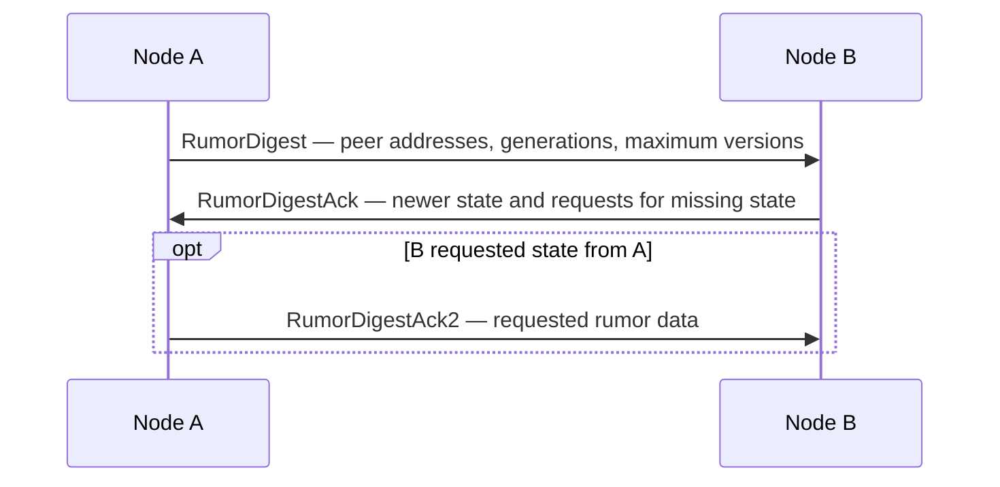

# Gossip

**A .NET 8 library for peer discovery and decentralized sharing of node state through a gossip protocol.**

Gossip lets nodes learn about one another and exchange small pieces of versioned information, called **rumors**. Each node maintains its own view of the cluster and periodically synchronizes with selected peers. Information can travel beyond the node that originally published it, without a central coordinator managing every exchange.

The repository contains a transport-independent protocol library and an HTTP-based integration test harness. It is a building block for distributed applications, with the current implementation best suited to experimentation and prototyping.

## What problem does it solve?

Nodes in a distributed application often need answers to two questions: **which peers do I know about, and what is their latest advertised state?** Maintaining a complete static peer list on every node becomes cumbersome as the cluster changes. Sending every state update directly to every other node also couples publishers to the full cluster membership.

Gossip addresses this by letting a node start with a few known peer addresses and exchange membership and state information incrementally. For example, a worker can publish `State = Normal`; other nodes can learn both that the worker exists and what state it advertises through repeated peer exchanges.

Potential uses include:

- Discovering peers in a group of cooperating services or workers.
- Sharing node metadata, such as a role, application status, or advertised capability.
- Maintaining a local view of active and unreachable peers.
- Studying gossip-based state propagation and convergence in a local cluster.

Updates propagate asynchronously, so different nodes can temporarily hold different views. Applications must tolerate that delay: the library does not implement consensus, leader election, transactions, or strongly consistent shared storage.

## Main capabilities

- **Seed-based discovery.** Configure initial peer addresses and learn about additional nodes through gossip exchanges.
- **Versioned node state.** Store rumors as string names and values with numeric versions. Newer versions replace older values for the same rumor name.
- **Generation-aware updates.** Each local peer receives a timestamp-based generation at creation. A newer remote generation replaces that peer's previous rumor set.
- **Digest-based synchronization.** Exchange peer summaries first, then transfer the rumor data needed to reconcile differences.
- **Heartbeat rumors.** Advance a built-in `HeartBeat` rumor on each outgoing gossip round.
- **Reachability tracking.** Move a peer to the unreachable set when the message sender reports a failed send; periodically select unreachable peers for another attempt.
- **Membership events.** Observe peer discovery, stale-peer removal, and changes to the unreachable set through `IPeerManager`.
- **Extensible integration.** Supply an `IMessageSender` transport and optionally an `IReceiversPicker` selection strategy. Register the core through Microsoft dependency injection.

## How it works

Each node stores its own state, known remote peers, and unreachable peer addresses. A rumor belongs to a particular peer; it is not a global key shared by all nodes.

At each configured interval, the node updates its heartbeat and selects recipients. The default picker attempts to choose a seed peer, a regular active peer, and a random unreachable peer when available. Selection of active peers favors those with fewer previous selections.

Synchronization uses a three-message exchange:



For a matching generation, the receiver compares maximum rumor versions and sends or requests newer data. An unknown peer or a newer generation triggers a request for its full state. Received information is incorporated into the local view and can be propagated in later rounds.

This reduces the need to send every rumor value in every round, although each outgoing digest still includes the local peer and all known active remote peers.

## Repository layout

```text
Gossip.sln
src/Gossip.Core/
  Abstractions/       Public interfaces, peers, rumors, and protocol messages
  Implementations/    Gossip loop, peer management, handlers, and receiver selection
  Registrars/         Dependency injection registration and configuration builder
tests/Gossip.IntegrationsTests/
  GossiperTests.cs    Discovery, reachability, and rumor propagation scenarios
  Framework/          ASP.NET Core hosts, HTTP transport, and JSON serialization
```

## Integrating the library

Reference [Gossip.Core](src/Gossip.Core/Gossip.Core.csproj) from your .NET application. The core does not start a network listener or provide a production transport; your application supplies those pieces.

### 1. Provide transport and logging

Implement `IMessageSender.Send(PeerAddress receiver, Message message, CancellationToken cancellationToken)` to deliver protocol messages. Return `MessageSendResult.Success` on success or `MessageSendResult.Fail` for a delivery failure. A reported failure immediately marks the receiver as unreachable.

On the receiving side, deserialize the appropriate message type and pass it to `IGossiper.Enqueue`. Register logging services as well: the gossip handlers resolve `ILogger<T>` from dependency injection.

The test harness provides reference implementations of [HTTP delivery](tests/Gossip.IntegrationsTests/Framework/MessageSenders/HttpMessageSender.cs), [JSON serialization](tests/Gossip.IntegrationsTests/Framework/Serializers/JsonMessageSerializer.cs), and [incoming request handling](tests/Gossip.IntegrationsTests/Framework/HostedServices/HttpHostedService.cs).

### 2. Register a node

The following registration fragment assumes `services` is your application's `IServiceCollection` and `MyMessageSender` is your own registered `IMessageSender` implementation:

```csharp
using Gossip.Core.Abstractions.Messages;
using Gossip.Core.Abstractions.Peers;
using Gossip.Core.Registrars;
using Microsoft.Extensions.DependencyInjection;

services.AddLogging();
services.AddSingleton<IMessageSender, MyMessageSender>();

services.AddGossiper(config => config
    .SetLocalPeerAddress(new PeerAddress(new Uri("http://localhost:5260/")))
    .SetRemoteStartingPeerAddresses(new[]
    {
        new PeerAddress(new Uri("http://localhost:5169/"))
    })
    .SetSyncDigestInMs(1000)
    .SetMessageSender(provider => provider.GetRequiredService<IMessageSender>()));
```

Use an explicit local URI that your transport can reach. A seed is an initial contact point, not an elected leader. A node with no seeds must be contacted by another node before it can discover peers through gossip.

### 3. Connect the lifecycle and publish state

Resolve `IGossiper` and call `Start` when the application starts. **`Start` returns the long-running gossip task**, so retain and observe it rather than awaiting it as a startup-completion signal. Call `Stop` during shutdown. The test harness's `HttpHostedService` illustrates the hosting integration.

Publish or update local metadata through `IPeerManager`:

```csharp
using Gossip.Core.Abstractions.Peers;
using Gossip.Core.Abstractions.Peers.Rumors;
using Microsoft.Extensions.DependencyInjection;

var peerManager = serviceProvider.GetRequiredService<IPeerManager>();

peerManager.LocalPeer.Apply(new Rumor(
    new RumorName("State"),
    new RumorValue("Normal"),
    RumorVersion.New()));

foreach (var peer in peerManager.ActiveRemotePeers)
{
    if (peer.Rumors.TryGetValue(new RumorName("State"), out var state))
    {
        Console.WriteLine($"{peer.Address.Value}: {state.Value.Value}");
    }
}
```

Create a fresh version for each update and leave the `HeartBeat` name to the protocol. Remote views refresh through subsequent gossip rounds.

## Configuration

Settings are exposed through `GossiperConfigBuilder`:

| Method | Default | Purpose |
| --- | --- | --- |
| `SetLocalPeerAddress` | Loopback-derived URI | The local node's address; set an explicit URI for your transport. |
| `SetRemoteStartingPeerAddresses` | Empty | Initial peer addresses used to bootstrap discovery. |
| `SetSyncDigestInMs` | `1000` | Delay between outgoing gossip rounds, in milliseconds. |
| `SetActiveRemotePeersCapacity` | `100` | Threshold for evicting the least recently updated non-seed peer when adding peers. |
| `SetUnreachableRemotePeersCapacity` | `100` | Intended capacity of the unreachable-peer set; see the implementation note below. |
| `SetMessageDispatcherCapacity` | `1000` | Capacity of the bounded incoming-message queue. |
| `SetMessageSender` | Required | Factory that supplies the outgoing transport. |
| `SetReceiversPicker` | `DefaultReceiversPicker` | Optional replacement for peer selection. |

**Implementation note:** `AddGossiper` currently passes the active-peer capacity to both peer-manager capacity settings, so the separate unreachable-peer capacity setting does not take effect. The test harness also uses different defaults: a 100 ms gossip interval, peer capacities of 1,000, and a queue capacity of 10,000.

## Building and running tests

Use the .NET 8 SDK or a compatible SDK. Running the integration tests also requires the .NET 8 and ASP.NET Core 8 runtimes and available localhost ports.

**Current build prerequisite:** [Gossip.Core.csproj](src/Gossip.Core/Gossip.Core.csproj) references `Microsoft.Extensions.Logging.Abstractions.dll` through a machine-specific `HintPath` into an ASP.NET Core `8.0.5` installation. On a machine without that assembly at the specified location, the build fails with missing logging types. Replace that reference with an appropriate `Microsoft.Extensions.Logging.Abstractions` package reference, or correct the assembly reference for your environment, before building.

Once that reference is resolved, run from the repository root:

```sh
dotnet restore Gossip.sln
dotnet build Gossip.sln --no-restore
dotnet test tests/Gossip.IntegrationsTests/Gossip.IntegrationsTests.csproj --no-build --filter "FullyQualifiedName~StartHost_SpreadsNewRumor"
```

The filtered test starts two HTTP hosts, publishes a rumor on one node, and checks that the other receives it. Other scenarios in [GossiperTests.cs](tests/Gossip.IntegrationsTests/GossiperTests.cs) cover discovery, unreachable peers, and discovery across 60 local hosts.

Run scenarios individually while exploring the repository. Tests reuse fixed ports (`5169`, `5260`, `5200–5209`, and `5300–5349`), and several do not stop the hosts they create. The timing experiments also contain busy-wait loops without timeouts, so running the entire suite can cause port conflicts or hang if convergence does not occur. These scenarios are examples, not published performance guarantees.

There is no standalone application entry point in the repository. The HTTP test hosts expose `/gossiper` for protocol traffic, `/peers` for inspecting local state, and `/add?rumorName=State&rumorValue=Normal` for adding a local rumor while a host is running.

## Current scope and limitations

- All peer and rumor state is held in memory; there is no persistence or rumor-deletion API.
- Heartbeats are propagated as state, but the core has no heartbeat-expiry failure detector. Reachability decisions depend on transport-reported send failures.
- A failed send is a local reachability observation, not proof that a process has stopped. Network failures can temporarily produce different membership views.
- Transport, serialization, authentication, encryption, and network timeout policies are responsibilities of the host application. The HTTP implementation lives in the test project.
- Generation and version checks help reconcile state, but the implementation does not provide a formal delivery or convergence guarantee under arbitrary failures or message reordering.
